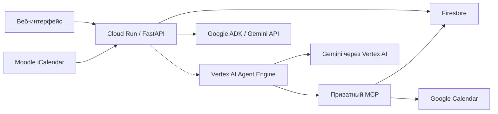

# CampusPulse AI

CampusPulse AI — название проекта для защиты 22 октября 2026 года. В текущей
версии интерфейса используется подпись «Google AI».

[](https://github.com/anuarmaksut711-dotcom/google_hack/actions/workflows/ci.yml)

Google AI помогает студенту собрать дедлайны Moodle и составить учебный план.
Облачное приложение использует Google-вход, личные данные каждого пользователя,
Gemini для диалога и Firestore для сохранения состояния. Отдельный recovery-агент
строит проверяемый план через MCP и Google Calendar.

**Приложение:** [открыть Google AI](https://campuspulse-403025736340.us-central1.run.app/login).

Кнопка с солнцем или луной вверху страницы переключает светлую и тёмную темы.
Выбор сохраняется в браузере и действует в чате, настройках и на страницах входа.

Основной стек: Python 3.12, FastAPI, Google ADK, Gemini API для обычного чата,
Vertex AI Agent Engine и Gemini через Vertex AI для recovery, MCP и Firestore.

## Текущее состояние

Проверка исходников для защиты: **22 октября 2026 года**, ветка `codex/pitch-ui-demo`.
Ниже — исторические облачные сведения из checkpoint **20 октября**; они не
подтверждают текущую опубликованную версию. Новый `setup/PITCH-CLOUD-HANDOFF.md`
Мерея отсутствовал в `origin/main` при подготовке. До его получения персональный
cloud recovery и запись в реальный Calendar считаются **непроверенными**.

[Аудит 22 октября](presentation/pitch-2026-10-22/PROJECT-AUDIT-2026-10-22.md)
разделяет локальные проверки, отдельную Calendar-ветку и опубликованную систему.
При read-only проверке сайта Moodle загрузился, но recovery был отключён, а
Google Calendar в проверенной сессии не подключён. Таблица ниже относится к
checkpoint 20 октября, а не к приёмке финального облачного сценария.

| Компонент | Состояние |
| --- | --- |
| Cloud Run, Google-вход, Firestore | Приложение развёрнуто; личные задания и история сохраняются между перезагрузками браузера. |
| Moodle и Gemini-чат | Проверены через опубликованный сайт: получены реальные задания и новый ответ Gemini по их дедлайнам. |
| Расписание занятий | Ручной ввод недельных пар опубликован на странице аккаунта. Расписание сохраняется, новые планы чата проверяются на пересечения с парами. |
| Автообновление Moodle | При открытии и каждые 5 минут в видимой вкладке; облачный планировщик обновляет данные каждые 15 минут при закрытом браузере. |
| Agent Engine и приватный MCP | Облачные ресурсы развёрнуты. Персональный recovery ещё требует согласованного обновления кода и настроек этих ресурсов. |
| Планирование → согласование → Google Calendar → verify | Код и автоматические проверки есть; персональный сценарий на опубликованном сайте пока выключен. |

Календарный экспорт Moodle предоставляет события и сроки. Он не предоставляет
оценки, факт сдачи и трудоёмкость заданий. Отметка «выполнено» в Google AI
является локальной отметкой пользователя, а ответ чата сам по себе не записывает
учебные блоки в Google Calendar.

Исторические облачные сведения и условия активации:
[rollout checkpoint](setup/RECOVERY-ROLLOUT-2026-10-20.md).
Результаты CI используют синтетические внешние сервисы и локальный эмулятор;
зелёный CI не подтверждает доступность реальных Gemini, Moodle или Calendar.

## Архитектура и инструменты



Пунктир показывает персональный recovery-путь, который ещё нужно включить.
Обычный чат уже работает через Cloud Run и Gemini API; он не вызывает инструменты
записи. Recovery использует следующие инструменты:

| Инструмент | Назначение |
| --- | --- |
| `read_assignments` | MCP: прочитать задания из настроенного источника и сохранить снимок. |
| `read_calendar` | MCP: прочитать занятые интервалы и существующие учебные блоки. |
| `solve_repair` | Function Calling: рассчитать предложение плана в пределах 72 часов. |
| `apply_plan` | MCP: применить сохранённую версию плана после отдельного подтверждения пользователя. |
| `verify_plan` | MCP: перечитать источники и независимо проверить результат применения. |

Версия и хеш плана связывают согласование с конкретным предложением. Изменение
исходных данных делает прежнее согласование недействительным. После неопределённого
результата записи автоматический повтор не выполняется. Журнал содержит события
вызовов и результаты проверки, а текст модели не считается доказательством записи.

Структура исходников:

- `src/campuspulse_recovery/agent/` — Google ADK, выбор инструментов и ограничения вызовов.
- `agent_engine/`, `cloud/` — runtime, транспорт, облачная композиция и привязки аккаунтов.
- `lms/`, `domain/`, `application/` — Moodle, ручное расписание, расчёт плана, согласование и проверка.
- `mcp_service/`, `storage/`, `security/` — MCP, состояние и контроль доступа.
- `web/` — интерфейс и его серверные маршруты.
- `tests/`, `evals/`, `requirements/` — тесты, отдельные evaluation-прогоны и lock-файлы.
- `deploy/`, `setup/` — скрипты развёртывания, инструкции и отчёты проверки.

Пути `agent_engine/`–`web/` относятся к `src/campuspulse_recovery/`.

## Быстрый запуск опубликованного приложения

1. Откройте [Google AI](https://campuspulse-403025736340.us-central1.run.app/login)
   и войдите через Google.
2. В Moodle AITU откройте **Календарь → Экспорт календаря**. Для полного источника
   планирования выберите **All events → Recent and next 60 days → Get calendar URL**.
3. Вставьте полученный адрес в форму **Моё подключение Moodle** на сайте.
   Ссылка даёт доступ к личному календарю: вводите её только в форму приложения.
4. Сверьте названия и сроки заданий с Moodle. Выполненные работы можно отметить
   в Google AI; это не отправляет работу и не меняет её статус в Moodle.
5. Отправьте в чат: «Назови два ближайших будущих дедлайна. Затем помоги составить
   план на три дня: сначала уточни мои свободные часы и оставшееся время на задания».

Для учёта пар заполните недельное расписание на странице аккаунта: предмет, день, время и период действия. [Инструкция](setup/MANUAL-SCHEDULE.md).
Чат учитывает введённые пары в рекомендациях. Для recovery свободные окна
пока задаются пользователем явно, с учётом пар и других обязательств.

## Подготовка к защите 22 октября

[Материалы защиты](presentation/pitch-2026-10-22/) содержат редактируемую
презентацию PPTX, PDF, сценарий демонстрации на 2–3 минуты, текст выступления и
ответы жюри. [UI handoff](setup/PITCH-UI-HANDOFF.md) фиксирует версию, проверки,
API и запросы к backend. Актуальные сведения о финальном облачном запуске должен
предоставить Мерей в `setup/PITCH-CLOUD-HANDOFF.md`.

Сценарий при включённом персональном recovery:

1. Войти и сверить задания Moodle; календарный экспорт не сообщает трудоёмкость.
2. Открыть «Настроить время на задания и свободные часы», сохранить оставшиеся
   минуты и конкретные интервалы. Перезагрузка должна вернуть сохранённые значения.
3. Нажать «Проверить расписание», просмотреть предложение и изменения «До/После».
4. Согласовать показанную версию и хеш. Отдельно нажать «Применить согласованную версию».
5. Открыть журнал: названия инструментов, их назначение и фактические результаты.
   Проверить итог в «Мой план» и сверить записи с Google Calendar.

«Результат неизвестен», «Применён частично», «Применён, проверка не подтверждена»
и «Проверка выявила расхождения» не означают успех. После потерянного ответа
сначала перечитайте состояние. Страница сохраняет точную версию для просмотра,
но блокирует действия до успешного чтения. Обновление и загрузка журнала не
согласуют и не применяют план. Снять старый выбор можно кнопкой «Снять выбор запуска».

Если сохранённый план прочитан, но сводка источников или evidence временно
недоступны, карточка остаётся доступна с предупреждением. Подтверждённый успех
и кнопки действий не показываются до успешного перечитывания. Ошибки доступа,
конфликт привязки и отозванная сессия не превращаются в такую карточку.

Журнал появляется после получения сохранённого `run_id`: текущий API не
предоставляет браузеру поток событий до ответа на создание запуска. На экране
нет вымышленных мыслей модели или предсказанных успешных вызовов.

## Локальное демо

После установки окружения из следующего раздела:

```sh
python -m campuspulse_recovery.demo --demo --port 8951
```

Откройте `https://127.0.0.1:8951/demo`. Демо использует тестовые данные и локальный
самоподписанный сертификат. В этом запуске внешняя сеть и Google credentials
отключены; настоящий Gemini не вызывается. Для остановки нажмите `Ctrl+C`.
Настоящий вход и личные данные проверяются в опубликованном приложении.

## Локальное подключение Google Calendar

Запуск: `./run-google-calendar.ps1`. Откройте
<https://127.0.0.1:8981/google-calendar>, добавьте JSON OAuth веб-клиента проекта
и предоставьте доступ в Google. Режим показывает реальные события на следующие
72 часа после подключения, с доступом только для чтения. Настройки и токены
сохраняются зашифрованно в профиле Windows вне репозитория.

Установка зависимостей, точный redirect URI и границы режима:
[локальный Google Calendar](setup/LOCAL-GOOGLE-CALENDAR.md).

## Установка для разработки и тестов

Требуется Python **3.12**. Выполняйте команды из корня репозитория.

macOS / Linux:

```sh
python3.12 -m venv .venv-test
source .venv-test/bin/activate
```

Windows PowerShell:

```powershell
py -3.12 -m venv .venv-test
.\.venv-test\Scripts\Activate.ps1
```

После активации окружения команды одинаковы:

```sh
python -m pip install --require-hashes -r requirements/test.lock
python -m pip install --no-deps --no-build-isolation .
python -m pip check
```

`test.lock` объединяет зависимости всех Python-компонентов и инструментов
тестирования. Для отдельных развёртываемых сервисов сохраняются их собственные
lock-файлы. Не объединяйте компонентные lock-файлы в одно окружение:
их транзитивные версии могут различаться.

## GitHub Actions

[Workflow CI](https://github.com/anuarmaksut711-dotcom/google_hack/actions/workflows/ci.yml)
запускается при push в `main`, для pull request и вручную через **Run workflow**.
Проверки выполняются на Ubuntu 24.04 с Python 3.12, Node.js 22, Java 21 и PowerShell 7.
Официальные Actions закреплены полными SHA; Python-зависимости устанавливаются
по хешам из `requirements/test.lock`, Firebase CLI закреплён на `15.34.0`.

Последовательность проверок:

1. `actionlint` проверяет YAML, параметры Actions и выражения workflow.
2. `deploy/run-rollout-checks.py` проверяет зависимости и запускает весь pytest
   с настоящим локальным Firestore Emulator, включая PowerShell-проверки деплоя.
3. Тот же gate запускает recovery evaluation в `offline` и voice evaluation
   в `literal-loopback`, собирает wheel/sdist и проверяет композицию MCP без вызова tools.
4. Любой failed/error/skipped pytest-тест завершает gate ошибкой. Успешный результат
   сохраняет SHA исходников, счётчики, результаты команд и хеши собранных пакетов.

На странице запуска есть сводка и артефакт `verification-<SHA>` со сроком хранения
14 дней: JUnit XML, логи, `qa-summary.json`, голосовой отчёт и wheel/sdist.
При неудаче сохраняются доступные логи. Облачные настройки, пользовательские данные
и credentials в артефакты не включаются.

Workflow проверяет код без секретов GCP, ключа Gemini и личного Moodle.
Он не разворачивает сервисы и не записывает события в реальные календари.
Проверки настоящих подключений описаны отдельно в [облачной инструкции](setup/CLOUD-CALENDAR.md).

## Основные тесты

### Голосовой ввод в веб-чате

При подключённом `AdkConversationAgent` кнопка «Голосовой ввод» использует
серверные credentials Gemini/Vertex AI. Gemini API распознаёт речь специализированной
моделью `gemini-3.5-transcribe`; для Vertex используется настроенная модель чата.
Язык определяется автоматически, включая смешанную речь; перевод не выполняется.
Индикатор показывает уровень звука; тишина и
слишком короткие записи не отправляются на распознавание. Нужны HTTPS (или
localhost для разработки), браузер с MediaRecorder и разрешение на микрофон.
Нажмите кнопку, произнесите сообщение и нажмите «Остановить запись».
Запись автоматически заканчивается через минуту; лимит загрузки — 4 МиБ.
Сервер отправляет аудио в Gemini для расшифровки, не сохраняет запись и добавляет
текст в черновик. Проверьте текст и отправьте сообщение обычной кнопкой.
При смене исходников перезапустите сервер и обновите страницу.

### Запуск проверок

```sh
python -m pytest -q
```

Pytest загружает текущие исходники из `src`. Проверки упаковки отдельно собирают
wheel и проверяют его содержимое. Установка проекта необходима также для проверки
импорта установленного пакета в изолированном дочернем Python.

Без Firestore Emulator интеграционные проверки хранилища пропускаются с объяснением.
Без PowerShell 7 также пропускаются проверки `tests/lms/test_deploy.py`.
Остальные тесты используют локальные тестовые данные и транспорт. Локальный прогон
с пропусками не равнозначен полному CI-прогону.

## Проверка настоящих транзакций Firestore локально

Для полного прогона нужны Java 21+, Node.js 22 или 24 LTS и PowerShell 7 на `PATH`.
Следующая команда скачивает официальный
Firebase CLI и Firestore Emulator при первом запуске, выполняет тесты и останавливает
эмулятор. Google-аккаунт и облачный проект для неё не нужны.

```sh
npx --yes firebase-tools@15.34.0 emulators:exec --only firestore --project demo-campuspulse-tests --config tests/firestore-emulator.json "python -m pytest -q"
```

Тестовая конфигурация слушает только `127.0.0.1:8686`. Проверки используют
анонимные credentials и отдельные тестовые пространства данных. Перед запуском
освободите порт, если другой экземпляр эмулятора уже работает.

При конкуренции эмулятор может завершить обе транзакции неопределённым результатом.
Процессный тест проверяет не более одного успешного захвата, сохранённого владельца
и захват свободной блокировки после завершения конкуренции. Это не проверка
гарантированного прогресса под нагрузкой или поведения облачного Firestore.

Отдельная проверка композиции MCP, которую также выполняет CI:

```sh
python deploy/check-recovery-composition.py
```

Ожидаемый результат — `offline_mcp_composition_ok`; инструменты не вызываются.

Документация: [Firebase Local Emulator Suite](https://firebase.google.com/docs/emulator-suite/install_and_configure).

## Offline evaluation

Эти проверки запускаются отдельно: для них нужны собственные сетевые guards.
Не запускайте весь каталог `evals` обычным pytest.

```sh
python -I -S -B evals/recovery/run_evaluation.py --mode offline --output .validation/recovery-review
python -B evals/voice/run_checks.py --mode literal-loopback --report .validation/voice-review/report.json -- evals/voice -q
```

Для повторного recovery evaluation выберите новый каталог `--output`: существующие
результаты намеренно не перезаписываются. SDK берётся из активного Python-окружения;
ручная настройка `PYTHONPATH` или Windows-путей не требуется.

Recovery evaluation использует scripted-модель и тестовые Google-адаптеры.
Voice evaluation проверяет локальные протоколы и инфраструктуру тестов.
Эти результаты не являются измерением качества речи или реальной модели Gemini.

## Сборка и обновление зависимостей

```sh
python -m build --no-isolation
```

Для пересоздания общего тестового lock-файла:

```sh
python -m pip install --require-hashes -r requirements/bootstrap.lock
python -m uv --no-config pip compile pyproject.toml --all-extras --universal --python-version 3.12.13 --constraint requirements/agent-linux.lock --constraint requirements/dev.lock --generate-hashes --no-header --no-annotate --output-file requirements/test.lock
```

После изменения деклараций зависимостей также пересоздайте затронутые компонентные
lock-файлы. В Windows существующий `requirements/resolve.ps1` обновляет компонентные
и общий тестовый lock-файлы через локальный `.tools/uv/bin/uv.exe`.

## Подключения и развёртывание

| Задача | Инструкция |
| --- | --- |
| Опубликованный сайт, Moodle/Gemini, проверка облачного smoke job | [CLOUD-CALENDAR.md](setup/CLOUD-CALENDAR.md) |
| Личное расписание пар AITU | [MY-DU.md](setup/MY-DU.md) |
| API оценок времени и свободных окон | [MOODLE-PLANNING.md](setup/MOODLE-PLANNING.md) |
| Персональные привязки и включение recovery на сайте | [RECOVERY-WEB-HANDOFF.md](setup/RECOVERY-WEB-HANDOFF.md) |
| Развёртывание и обновление Agent Engine/MCP | [RECOVERY-GCP-DEPLOY.md](setup/RECOVERY-GCP-DEPLOY.md) |
| Параметры существующих ресурсов и проверенный контракт | [RECOVERY-GCP-HANDOFF.md](setup/RECOVERY-GCP-HANDOFF.md) |
| Последний rollout, проверенная сборка и условия активации | [RECOVERY-ROLLOUT-2026-10-20.md](setup/RECOVERY-ROLLOUT-2026-10-20.md) |
| Offline-подготовка пакета Agent Engine | [AGENT-ENGINE.md](setup/AGENT-ENGINE.md) |

Перед обновлением облака сверяйте текущую версию и привязки с последним checkpoint.
Сам по себе успешный offline-подготовщик не разворачивает Agent Engine.
CI не заменяет отдельную проверку доступов и приёмку опубликованной версии.

Приватные настройки хранятся в `.campuspulse-local/` и Secret Manager.
Ключи Gemini, токены, личные ссылки Moodle, коды My DU и приватные привязки аккаунтов
не добавляются в Git, issue, README или отчёты CI. Ключи сервисных аккаунтов
для описанного облачного пути не требуются: используются runtime identities и IAM.

## Что осталось для демонстрации кейса

1. Подготовить реальные привязки разрешённых пользователей и отдельные тестовые
   Google-календари с правами MCP identity. Текущий rollout-подготовщик ожидает
   двух пользователей и два разных календаря для проверки изоляции.
2. Обновить существующие Engine и MCP согласованными wheel/settings, затем включить
   recovery в настройках сайта. Дождаться завершения обновления и проверить контракт.
3. Пройти реальный сценарий: Moodle → трудоёмкость и свободные окна → вызовы MCP →
   предложение → подтверждение точной версии → запись в тестовый Calendar → verify.
   Проверить отсутствие дублей при повторе, отказ устаревшего согласования и
   недоступность чужих запусков второму пользователю.
4. Показать в интерфейсе журнал реальных вызовов инструментов и результат независимой
   проверки. Обычный текстовый ответ Gemini не подтверждает этот сценарий.
5. Перед выступлением открыть [подготовленные материалы](presentation/pitch-2026-10-22/),
   обновить облачные факты по handoff Мерея и записать резервное видео реального
   сценария. Причина отсутствия real-cloud видео и инструкция находятся в материалах.

My DU убран из текущего приложения. Ручные пары учитываются в рекомендациях чата;
для recovery свободные окна по-прежнему задаются явно.
