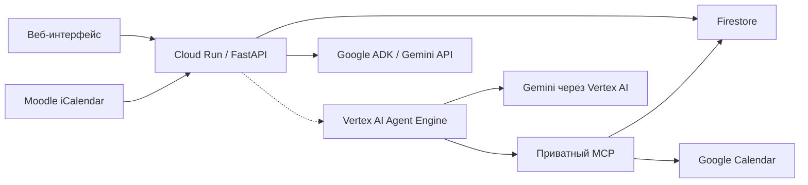

# CampusPulse AI

[](https://github.com/anuarmaksut711-dotcom/google_hack/actions/workflows/ci.yml)

CampusPulse помогает студенту собрать дедлайны Moodle и составить учебный план.
Облачное приложение использует Google-вход, личные данные каждого пользователя,
Gemini для диалога и Firestore для сохранения состояния. Отдельный recovery-агент
строит проверяемый план через MCP и Google Calendar.

**Приложение:** [открыть CampusPulse](https://campuspulse-585736102295.us-central1.run.app/login).

Основной стек: Python 3.12, FastAPI, Google ADK, Gemini API для обычного чата,
Vertex AI Agent Engine и Gemini через Vertex AI для recovery, MCP и Firestore.

## Текущее состояние

Статус на **20 октября 2026 года**:

| Компонент | Состояние |
| --- | --- |
| Cloud Run, Google-вход, Firestore | Приложение развёрнуто; личные задания и история сохраняются между перезагрузками браузера. |
| Moodle и Gemini-чат | Проверены через опубликованный сайт: получены реальные задания и новый ответ Gemini по их дедлайнам. |
| My DU | Подключение реализовано; реальный Microsoft-вход и соответствие импортированных пар требуют проверки с аккаунтом AITU. |
| Agent Engine и приватный MCP | Облачные ресурсы развёрнуты. Персональный recovery ещё требует согласованного обновления кода и настроек этих ресурсов. |
| Планирование → согласование → Google Calendar → verify | Код и автоматические проверки есть; персональный сценарий на опубликованном сайте пока выключен. |

Календарный экспорт Moodle предоставляет события и сроки. Он не предоставляет
оценки, факт сдачи и трудоёмкость заданий. Отметка «выполнено» в CampusPulse
является локальной отметкой пользователя, а ответ чата сам по себе не записывает
учебные блоки в Google Calendar.

Актуальные облачные сведения и оставшиеся условия активации:
[rollout checkpoint](setup/RECOVERY-ROLLOUT-2026-10-20.md).
Результаты CI используют синтетические внешние сервисы и локальный эмулятор;
зелёный CI не подтверждает доступность реальных Gemini, Moodle или Calendar.

## Архитектура и инструменты



Пунктир показывает персональный recovery-путь, который ещё нужно включить.
Обычный чат уже работает через Cloud Run и Gemini API; он не вызывает инструменты
записи. Recovery использует следующие инструменты:

| Инструмент | Назначение |
| --- | --- |
| `read_assignments` | MCP: прочитать задания из настроенного источника и сохранить снимок. |
| `read_calendar` | MCP: прочитать занятые интервалы и существующие учебные блоки. |
| `solve_repair` | Function Calling: рассчитать предложение плана в пределах 72 часов. |
| `apply_plan` | MCP: применить сохранённую версию плана после отдельного подтверждения пользователя. |
| `verify_plan` | MCP: перечитать источники и независимо проверить результат применения. |

Версия и хеш плана связывают согласование с конкретным предложением. Изменение
исходных данных делает прежнее согласование недействительным. После неопределённого
результата записи автоматический повтор не выполняется. Журнал содержит события
вызовов и результаты проверки, а текст модели не считается доказательством записи.

Структура исходников:

- `src/campuspulse_recovery/agent/` — Google ADK, выбор инструментов и ограничения вызовов.
- `agent_engine/`, `cloud/` — runtime, транспорт, облачная композиция и привязки аккаунтов.
- `lms/`, `domain/`, `application/` — Moodle/My DU, расчёт плана, согласование и проверка.
- `mcp_service/`, `storage/`, `security/` — MCP, состояние и контроль доступа.
- `web/` — интерфейс и его серверные маршруты.
- `tests/`, `evals/`, `requirements/` — тесты, отдельные evaluation-прогоны и lock-файлы.
- `deploy/`, `setup/` — скрипты развёртывания, инструкции и отчёты проверки.

Пути `agent_engine/`–`web/` относятся к `src/campuspulse_recovery/`.

## Быстрый запуск опубликованного приложения

1. Откройте [CampusPulse](https://campuspulse-585736102295.us-central1.run.app/login)
   и войдите через Google.
2. В Moodle AITU откройте **Календарь → Экспорт календаря**. Для полного источника
   планирования выберите **All events → Recent and next 60 days → Get calendar URL**.
3. Вставьте полученный адрес в форму **Моё подключение Moodle** на сайте.
   Ссылка даёт доступ к личному календарю: вводите её только в форму приложения.
4. Сверьте названия и сроки заданий с Moodle. Выполненные работы можно отметить
   в CampusPulse; это не отправляет работу и не меняет её статус в Moodle.
5. Отправьте в чат: «Назови два ближайших будущих дедлайна. Затем помоги составить
   план на три дня: сначала уточни мои свободные часы и оставшееся время на задания».

Для учёта пар подключите My DU на странице аккаунта по [инструкции](setup/MY-DU.md).
Чат учитывает импортированные пары в рекомендациях. Для recovery свободные окна
пока задаются пользователем явно, с учётом пар и других обязательств.

## Локальное демо

После установки окружения из следующего раздела:

```sh
python -m campuspulse_recovery.demo --demo --port 8951
```

Откройте `https://127.0.0.1:8951/demo`. Демо использует тестовые данные и локальный
самоподписанный сертификат. В этом запуске внешняя сеть и Google credentials
отключены; настоящий Gemini не вызывается. Для остановки нажмите `Ctrl+C`.
Настоящий вход и личные данные проверяются в опубликованном приложении.

## Установка для разработки и тестов

Требуется Python **3.12**. Выполняйте команды из корня репозитория.

macOS / Linux:

```sh
python3.12 -m venv .venv-test
source .venv-test/bin/activate
```

Windows PowerShell:

```powershell
py -3.12 -m venv .venv-test
.\.venv-test\Scripts\Activate.ps1
```

После активации окружения команды одинаковы:

```sh
python -m pip install --require-hashes -r requirements/test.lock
python -m pip install --no-deps --no-build-isolation .
python -m pip check
```

`test.lock` объединяет зависимости всех Python-компонентов и инструментов
тестирования. Для отдельных развёртываемых сервисов сохраняются их собственные
lock-файлы. Не объединяйте компонентные lock-файлы в одно окружение:
их транзитивные версии могут различаться.

## Основные тесты

```sh
python -m pytest -q
```

Pytest загружает текущие исходники из `src`. Проверки упаковки отдельно собирают
wheel и проверяют его содержимое. Установка проекта необходима также для проверки
импорта установленного пакета в изолированном дочернем Python.

Без Firestore Emulator интеграционные проверки хранилища пропускаются с объяснением.
Остальные тесты используют локальные тестовые данные и транспорт.

## Проверка настоящих транзакций Firestore локально

Требуются Java 21+ и Node.js 22 или 24 LTS. Следующая команда скачивает официальный
Firebase CLI и Firestore Emulator при первом запуске, выполняет тесты и останавливает
эмулятор. Google-аккаунт и облачный проект для неё не нужны.

```sh
npx --yes firebase-tools@15.34.0 emulators:exec --only firestore --project demo-campuspulse-tests --config tests/firestore-emulator.json "python -m pytest -q"
```

Тестовая конфигурация слушает только `127.0.0.1:8686`. Проверки используют
анонимные credentials и отдельные тестовые пространства данных. Перед запуском
освободите порт, если другой экземпляр эмулятора уже работает.

При конкуренции эмулятор может завершить обе транзакции неопределённым результатом.
Процессный тест проверяет не более одного успешного захвата, сохранённого владельца
и захват свободной блокировки после завершения конкуренции. Это не проверка
гарантированного прогресса под нагрузкой или поведения облачного Firestore.

Документация: [Firebase Local Emulator Suite](https://firebase.google.com/docs/emulator-suite/install_and_configure).

## Offline evaluation

Эти проверки запускаются отдельно: для них нужны собственные сетевые guards.
Не запускайте весь каталог `evals` обычным pytest.

```sh
python -I -S -B evals/recovery/run_evaluation.py --mode offline --output .validation/recovery-review
python -B evals/voice/run_checks.py --mode literal-loopback --report .validation/voice-review/report.json -- evals/voice -q
```

Для повторного recovery evaluation выберите новый каталог `--output`: существующие
результаты намеренно не перезаписываются. SDK берётся из активного Python-окружения;
ручная настройка `PYTHONPATH` или Windows-путей не требуется.

Recovery evaluation использует scripted-модель и тестовые Google-адаптеры.
Voice evaluation проверяет локальные протоколы и инфраструктуру тестов.
Эти результаты не являются измерением качества речи или реальной модели Gemini.

## Сборка и обновление зависимостей

```sh
python -m build --no-isolation
```

Для пересоздания общего тестового lock-файла:

```sh
python -m pip install --require-hashes -r requirements/bootstrap.lock
python -m uv --no-config pip compile pyproject.toml --all-extras --universal --python-version 3.12.13 --constraint requirements/agent-linux.lock --constraint requirements/dev.lock --generate-hashes --no-header --no-annotate --output-file requirements/test.lock
```

После изменения деклараций зависимостей также пересоздайте затронутые компонентные
lock-файлы. В Windows существующий `requirements/resolve.ps1` обновляет компонентные
и общий тестовый lock-файлы через локальный `.tools/uv/bin/uv.exe`.
