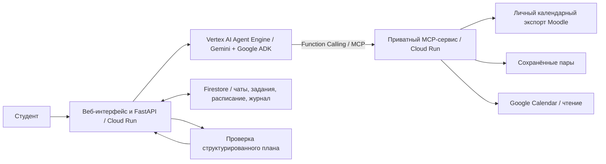

# Google AI

[](https://github.com/anuarmaksut711-dotcom/google_hack/actions/workflows/ci.yml)

[Открыть Google AI](https://campuspulse-403025736340.us-central1.run.app/#workspace) · [Презентация PDF](presentation/pitch-2026-10-22/output/CampusPulse-AI-Pitch-2026-10-22-final.pdf) · [Презентация PPTX](presentation/pitch-2026-10-22/output/CampusPulse-AI-Pitch-2026-10-22-final.pptx)

[Возможности](#что-умеет-приложение) · [Демо](#попробовать-на-реальных-заданиях) · [Архитектура](#архитектура) · [Локальный запуск](#установка-для-разработки) · [Деплой](#развёртывание-в-google-cloud)

## Какую проблему решаем

Задания находятся в Moodle, пары — в отдельном расписании, личные дела — в календаре.
Чтобы понять, за что браться сегодня, студенту приходится собирать эту информацию вручную.

Google AI объединяет эти источники в одном рабочем пространстве. Студент задаёт
свободное время и примерную длительность работы, а агент получает актуальные данные
через MCP и предлагает конкретные учебные блоки. В интерфейсе видно, какие инструменты
он вызвал и что удалось прочитать.

## Что умеет приложение

| Возможность | Как это работает |
| --- | --- |
| **Мои задания** | Дедлайны из личного календарного экспорта Moodle: ближайшие, прошедшие и отмеченные пользователем как выполненные. |
| **Пары и время** | Загрузка PDF, PNG или JPEG до 8 МиБ, распознавание расписания и редактирование пар по дням. Можно добавить несколько пар за день или заполнить неделю вручную. |
| **План в чате** | Агент читает задания и расписание, учитывает сроки, занятость, свободные часы и длительность заданий. Если данных не хватает, запрашивает уточнение. |
| **Действия агента** | Реальные вызовы MCP: инструмент, состояние, длительность и количество полученных записей. Журнал сохраняется вместе с ответом. |
| **Google Calendar** | Чтение занятости при подключённом календаре. Подготовка пар и учебных блоков к добавлению; запись выполняется отдельным действием после подтверждения. |
| **Личное рабочее пространство** | Вход через Google, чаты и проекты, сохранённые задания и расписание с привязкой к пользователю. |
| **Голосовой ввод** | Запись речи в браузере и расшифровка в черновик сообщения. Текст можно проверить перед отправкой. |

Сайт использует общий тёмный интерфейс и одинаковую сворачиваемую боковую панель
на рабочих страницах.

## Попробовать на реальных заданиях

Текущая интеграция поддерживает **Moodle AITU — `https://lms.astanait.edu.kz`**.
Произвольные Moodle-серверы других университетов пока не подключаются.

1. Откройте [рабочий сайт](https://campuspulse-403025736340.us-central1.run.app/login) и войдите через Google.
2. В Moodle откройте **Календарь → Экспорт календаря**. Выберите **All events → Recent and next 60 days → Get calendar URL**.
3. В настройках сайта подключите полученную ссылку через **Моё подключение Moodle**. Она даёт доступ к вашему календарному экспорту — не публикуйте её.
4. Откройте **Мои задания** и сверьте ближайшие сроки с Moodle.
5. В разделе **Пары и время** загрузите расписание или добавьте пары вручную. Проверьте предметы, дни, время и период действия, затем нажмите **Сохранить расписание**.
6. Отправьте запрос в чат и раскройте блок **Действия агента**.

Пример запроса для демонстрации без записи в календарь:

> Составь план на ближайшие три дня по моим реальным заданиям Moodle. Я свободен с 19:00 до 21:00, на каждое задание нужно примерно 45 минут. Учти мои пары и занятость подключённого календаря. Покажи, что делать и когда. В Google Calendar ничего не добавляй.

Для этого сценария достаточно чтения источников. Подключение Google Calendar
нужно для проверки его событий; без подключения агент должен явно обозначить,
что эта занятость не проверена. Отсутствие сохранённых пар также не означает,
что студент свободен всю неделю.

При загрузке расписания каждый следующий файл дополняет черновик. Распознанные
строки можно исправить до сохранения. Файл отправляется настроенному AI-провайдеру
по кнопке распознавания; приложение не сохраняет оригинал файла.

Пары также можно описать в чате: ассистент подготовит черновик для просмотра
и сохранения в редакторе. В следующих планах используется сохранённая версия расписания.

## Как агент принимает решения

1. **Получает запрос.** Backend связывает обращение с текущим пользователем и сессией и передаёт его в Vertex AI Agent Engine.
2. **Выбирает инструменты.** Gemini через Google ADK решает, какие данные нужны. Для учебного плана доступны `read_assignments` и `read_schedule`.
3. **Читает реальные источники через MCP.** Инструменты получают актуальные задания, сохранённые пары и события подключённого календаря. Ошибка источника остаётся явной ошибкой.
4. **Уточняет или составляет план.** Модель использует результаты вызовов, запрос студента и историю диалога. Для плана требуется чтение обоих инструментов.
5. **Проходит проверку.** Структурированный ответ проверяется сервером: формат, сроки, доступные данные и пересечения с сохранёнными парами.
6. **Показывает результат.** Студент получает ответ и фактический журнал вызовов. Получение плана в чате само по себе не создаёт событий в календаре.

Блок «Действия агента» показывает наблюдаемые этапы выполнения и результаты
инструментов. Он не имитирует внутренние мысли модели и не рисует успешные вызовы заранее.

### MCP и Function Calling

| Инструмент | Данные и назначение | Кто вызывает |
| --- | --- | --- |
| `read_assignments` | Обновляет и читает реальные дедлайны Moodle текущего пользователя, исключает локально выполненные задания. | Study-agent в Agent Engine через Function Calling → MCP. |
| `read_schedule` | Читает сохранённую неделю пар, её период действия и актуальные события подключённого Google Calendar. | Study-agent в Agent Engine через Function Calling → MCP. |
| `read_calendar` | Повторно читает календарь для серверной проверки предложения и конфликтов. | Backend в отдельном календарном сценарии. |
| `apply_plan` | Применяет точную подтверждённую версию предложения. | Backend после явного подтверждения и отдельного нажатия применения. |
| `verify_plan` | Заново читает события и проверяет результат применения. | Backend в календарном сценарии. |

У study-agent есть только два инструмента чтения. Инструменты записи не передаются
модели. Транспорт добавляет служебное разрешение вызова; модель не выбирает чужой
аккаунт и не получает OAuth-токены или личную ссылку Moodle.

## Архитектура



Веб-клиент обращается к backend, а не напрямую к Agent Engine или приватному MCP.
Backend вызывает управляемую операцию `async_query`. Для запроса и каждого
инструмента выдаются ограниченные по времени разрешения с привязкой к пользователю,
живой сессии и конкретному действию. MCP использует Streamable HTTP.

Календарная запись — отдельный путь: **предложение → просмотр → подтверждение
точной версии → применение → независимая проверка**. Изменение исходного расписания
делает старое предложение неактуальным. Если результат записи неизвестен,
сначала выполняется проверка, а не повторное добавление событий.

### Технологии

| Уровень | Технологии |
| --- | --- |
| Язык и backend | Python 3.12, FastAPI, Pydantic |
| Модель и оркестрация | Gemini через Vertex AI, Google ADK, Function Calling |
| Управляемый агент | Vertex AI Agent Engine / Reasoning Engine |
| Инструменты | MCP Python SDK / FastMCP, Streamable HTTP |
| Интерфейс | Серверный HTML, CSS и JavaScript |
| Хостинг | Google Cloud Run |
| Состояние | Google Cloud Firestore |
| Вход и секреты | Google Sign-In / OAuth, IAM, Secret Manager |
| Проверки и сборка | Pytest, Firestore Emulator, GitHub Actions, Cloud Build |

### Соответствие кейсу GDG Astana

Тема кейса хакатона — **CampusPulse AI: Smart Autonomous AI Agent with MCP Support**.
Наше решение для этого кейса — **Google AI**.

| Требование | Реализация в проекте |
| --- | --- |
| Gemini и автономный выбор инструментов | ADK-agent с циклом вызовов инструментов и структурированным результатом. |
| MCP / custom Tools и реальные данные | Собственный MCP-сервер; задания Moodle, пары и Google Calendar вместо статического набора данных в рабочем приложении. |
| Облачный Agent Engine и API | Управляемый runtime с операцией `async_query`; сайт вызывает его через авторизованный backend. |
| Интерфейс и визуализация работы | Рабочий веб-клиент, чат и сохранённые наблюдения реальных вызовов MCP. |
| Репозиторий и материалы защиты | Исходники, lock-файлы, скрипты деплоя, тесты, PDF и PPTX. |

## Структура репозитория

```text
src/campuspulse_recovery/
├── agent/          # ADK, настройки модели и обработка диалога
├── agent_engine/   # Runtime для Vertex AI Agent Engine
├── cloud/          # Облачная композиция, study MCP и привязки сессий
├── lms/            # Moodle, расписание пар, импорт и планирование
├── domain/         # Типизированные модели и правила
├── application/    # Сценарии подготовки, применения и проверки
├── mcp_service/    # MCP-инструменты календарного/recovery-сценария
├── storage/        # Хранение состояния и операций
├── security/       # Авторизация и границы доступа
├── web/            # Интерфейс, API, страницы и клиентская логика
└── demo/           # Изолированное локальное демо
deploy/            # Сборка, проверки и облачное развёртывание
requirements/      # Закреплённые зависимости с хешами
tests/             # Автоматические проверки
evals/             # Отдельные evaluation-прогоны
setup/             # Подробные инструкции и история проверок
presentation/      # Презентация и материалы выступления
```

Ключевые файлы: [runtime агента](src/campuspulse_recovery/agent_engine/study_runtime.py),
[study MCP](src/campuspulse_recovery/cloud/study_mcp.py),
[вызов агента с сайта](src/campuspulse_recovery/cloud/study_conversation.py),
[права вызова инструментов](src/campuspulse_recovery/cloud/study_grants.py),
[облачная композиция сайта](src/campuspulse_recovery/cloud/calendar_app.py).

## Установка для разработки

Нужны **Git и Python 3.12**. Проект требует `>=3.12,<3.13`.
Команды ниже выполняются из корня репозитория.

```sh
git clone https://github.com/anuarmaksut711-dotcom/google_hack.git
cd google_hack
```

Создайте и активируйте окружение.

**Windows PowerShell:**

```powershell
py -3.12 -m venv .venv-test
.\.venv-test\Scripts\Activate.ps1
```

**macOS / Linux:**

```sh
python3.12 -m venv .venv-test
source .venv-test/bin/activate
```

После активации:

```sh
python -m pip install --require-hashes -r requirements/test.lock
python -m pip install --no-deps --no-build-isolation .
python -m pip check
```

`requirements/test.lock` — общее окружение разработки и тестов. Развёртываемые
компоненты используют собственные lock-файлы; объединять их в одно окружение
вместо `test.lock` не нужно.

### Локальное демо без облачных доступов

```sh
python -m campuspulse_recovery.demo --demo --port 8951
```

Откройте **https://127.0.0.1:8951/demo**. При первом входе браузер предупредит
о локальном самоподписанном сертификате. Для остановки нажмите `Ctrl+C`.

Эта команда запускает изолированное демо с синтетическими данными и блокировкой
внешней сети и облачных credentials. Реальные Google-вход, Moodle, Gemini и
Agent Engine проверяются в рабочем облачном приложении. Локальное демо не требует
ввода настоящих Google-данных.

## Тесты и качество

Обычный локальный запуск:

```sh
python -m pytest -q
```

Для полного прогона дополнительно нужны **Node.js 22, Java 21+ и PowerShell 7**
на `PATH`. Firestore Emulator запускается следующей командой:

```sh
npx --yes firebase-tools@15.34.0 emulators:exec --only firestore --project demo-campuspulse-tests --config tests/firestore-emulator.json "python -m pytest -q"
```

При первом запуске скачиваются Firebase CLI и эмулятор. Он слушает только
`127.0.0.1:8686`; настоящий облачный проект и Google-аккаунт для тестов не нужны.
Без эмулятора часть тестов хранилища будет пропущена; без PowerShell 7 будут
пропущены соответствующие проверки деплоя.

Отдельные проверки, которые также входят в CI:

```sh
python -I -S -B evals/recovery/run_evaluation.py --mode offline --output .validation/recovery-review
python -B evals/voice/run_checks.py --mode literal-loopback --report .validation/voice-review/report.json -- evals/voice -q
python deploy/check-recovery-composition.py
python -m build --no-isolation
```

Для повторного recovery evaluation укажите новый каталог `--output`.
Каталог `evals` запускается через свои команды, отдельно от обычного pytest.

[GitHub Actions](.github/workflows/ci.yml) выполняет полный Linux gate: проверку
workflow и зависимостей, pytest с Firestore Emulator, offline evaluations,
сборку пакета и проверку MCP-композиции. Пропущенный тест в полном gate считается ошибкой.
Workflow запускается при push в `main`, для pull request и вручную; сам по себе
он не разворачивает приложение.

Проверенная кодовая база от **22 октября 2026 года** —
[`731aa8e`](https://github.com/anuarmaksut711-dotcom/google_hack/commit/731aa8e004c93095bae53a957c4479aceda78ec6):
**2620 тестов, 0 ошибок, 0 падений, 0 пропусков** в полном Linux-прогоне;
[GitHub CI завершён успешно](https://github.com/anuarmaksut711-dotcom/google_hack/actions/runs/39706867722).
Автотесты используют синтетические внешние сервисы и эмулятор. Они не заменяют
живую проверку подключения Moodle, модели или личного календаря.

## Развёртывание в Google Cloud

### Рабочая конфигурация

| Компонент | Текущий путь |
| --- | --- |
| GCP | Проект `project-e25873c6-e889-40bb-86d`, регион сервисов `us-central1`. |
| Сайт | Cloud Run `campuspulse`, запуск `python -m campuspulse_recovery.cloud.calendar_app`. |
| MCP | Приватный Cloud Run `campuspulse-mcp`, `/study/mcp`; запуск `python /app/mcp-entrypoint.py` с `CAMPUSPULSE_MCP_APP_FACTORY=campuspulse_recovery.cloud.study_mcp:create_app`. |
| Agent Engine | Существующий `projects/403025736340/locations/us-central1/reasoningEngines/8841397574196789248`, операция `async_query`. |
| Хранение | Firestore, база `campuspulse-calendar`. |
| Сборка | [study-cloudbuild.json](deploy/study-cloudbuild.json) и [Dockerfile.rollout](deploy/Dockerfile.rollout). |

### Настройки и доступы

Для облачного запуска нужны настроенные ресурсы GCP, биллинг и API, OAuth
веб-клиент с redirect URI рабочего сайта, Firestore, приватные bucket и Artifact
Registry, отдельные service accounts и разрешения на вызов сервисов.

Сайт и MCP читают секреты из смонтированных файлов:

| Параметр | Содержимое |
| --- | --- |
| `CAMPUSPULSE_CALENDAR_SETTINGS` | Путь к JSON по схеме `CalendarSettings`: `application`, `origin`, `google_client_id`, `chat`, `scheduler_service_account`, `study_agent`. |
| `CAMPUSPULSE_CALENDAR_OAUTH` | Путь к приватному JSON конфигурации календарного OAuth и шифрования. |
| `study_agent` | `target`, `agent_audience`, `mcp_origin`, `backend_service_account`, `agent_service_account`; схема — [StudyAgentSettings](src/campuspulse_recovery/cloud/study_grants.py). |

[config.example.json](config.example.json) описывает только базовый `AppConfig`.
Это не полный файл настроек облачного сайта. Схема полной конфигурации находится
в [calendar_app.py](src/campuspulse_recovery/cloud/calendar_app.py).
Приватные значения хранятся вне Git, локально в `.campuspulse-local/` и в Secret Manager.

### Порядок обновления

1. Выберите точный коммит и соберите чистый экспорт исходников через `git archive`.
2. Запустите Cloud Build с [study-cloudbuild.json](deploy/study-cloudbuild.json) и `_SOURCE_SHA`, равным этому коммиту. Сборка выполняет полный gate и выпускает образ, wheel и отчёт проверки.
3. Сохраните текущие ревизии, трафик, версии настроек и ссылки на пакеты Engine для отката.
4. При изменении runtime обновите MCP и существующий Agent Engine из проверенных артефактов. Wheel и исходники команды деплоя должны соответствовать одному коммиту.
5. Обновите сайт, сохранив нужные entrypoint, IAM, runtime identities и mounts секретов. Для MCP и сайта используется проверенный образ по digest.
6. Проверьте `/health`, Google-вход, реальный запрос на сайте и сохранённый журнал инструментов. Запись в календарь проверяется отдельно от сценария чтения.

Обновление Agent Engine выполняет [deploy/study-agent.py](deploy/study-agent.py).
Доступные параметры можно посмотреть без деплоя:

```sh
python deploy/study-agent.py --help
```

Шаблон команды для Bash из окружения Python 3.12 с зависимостями
`requirements/cloud-linux.lock` приведён ниже. Подставьте путь к проверенному
wheel, его SHA-256, приватный JSON и существующий staging bucket.
**Выполнение этой команды обновляет действующий Agent Engine.**

```sh
python deploy/study-agent.py \
  --settings .campuspulse-local/cloud-settings.json \
  --wheel verification/dist/campuspulse_recovery-0.1.0-py3-none-any.whl \
  --wheel-sha256 "<SHA256_VERIFIED_WHEEL>" \
  --requirements requirements/cloud-linux.lock \
  --staging-bucket "gs://<EXISTING_PRIVATE_BUCKET>" \
  --project project-e25873c6-e889-40bb-86d \
  --location us-central1 \
  --resource projects/403025736340/locations/us-central1/reasoningEngines/8841397574196789248
```

Активный скрипт использует Vertex AI SDK и обновляет существующий Engine.
Он не создаёт дубликат Engine, bucket или IAM-привязки и проверяет конкретный
проект команды. Для переноса в новый GCP-проект потребуются подготовка ресурсов
и адаптация этих явных привязок; универсального развёртывания одной командой нет.

Подробности контракта и порядок релиза:
[PITCH-CLOUD-HANDOFF.md](setup/PITCH-CLOUD-HANDOFF.md).
Этот документ содержит историю нескольких релизов: его старые SHA, ревизии и
замеры относятся к указанным в нём этапам, а не автоматически к текущему трафику.

## Ограничения и работа с данными

- **Moodle iCalendar — источник событий и сроков.** Он не сообщает оценки, факт сдачи и оставшуюся трудоёмкость. Длительность работы задаёт студент; отметка выполнения в приложении не меняет Moodle.
- **Расписание нужно проверить.** Скриншот одного дня не подтверждает полноту недели. Распознавание может ошибаться; чередующиеся недели и нечитаемые строки требуют ручной правки.
- **Горизонт учебного плана — ближайшие 72 часа.** Сохранённая неделя пар задаётся на явный период до 91 дня. Часовой пояс учитывается при работе с интервалами.
- **Неполные источники обозначаются явно.** План без сохранённых пар или подключённого календаря не выдаётся за полную проверку всей занятости.
- **Получение ответа и сохранение пар не означают запись событий.** При подключённом календаре с доступом записи сохранение пар может подготовить предложение. Также есть кнопка «Подготовить пары для Google Calendar»; применение остаётся отдельным подтверждённым действием.
- **Частичный или неизвестный результат записи не считается успехом.** Сначала нужно проверить уже созданные события. Изменение сохранённых пар не удаляет ранее добавленные события из Google Calendar.
- **Данные разделены по пользователям.** Сервер проверяет сессию и права на операции. Токены, личные Moodle URL, cookies и оригиналы личных расписаний не должны попадать в Git, публичные отчёты или материалы защиты.
- **Голосовой ввод требует HTTPS и разрешения на микрофон.** Аудио отправляется провайдеру для расшифровки; приложение не сохраняет запись. Распознанный текст сначала появляется в черновике.

## Материалы защиты и дополнительные инструкции

| Материал | Ссылка |
| --- | --- |
| Презентация PDF | [Открыть PDF](presentation/pitch-2026-10-22/output/CampusPulse-AI-Pitch-2026-10-22-final.pdf) |
| Редактируемая презентация | [Открыть PPTX](presentation/pitch-2026-10-22/output/CampusPulse-AI-Pitch-2026-10-22-final.pptx) |
| Выступление и вопросы жюри | [Текст выступления](presentation/pitch-2026-10-22/SPEECH-RU.md), [ответы жюри](presentation/pitch-2026-10-22/JURY-QA-RU.md) |
| Контракт облачного study-agent и история проверок | [PITCH-CLOUD-HANDOFF.md](setup/PITCH-CLOUD-HANDOFF.md) |
| История интеграции интерфейса | [PITCH-UI-HANDOFF.md](setup/PITCH-UI-HANDOFF.md) |
| Локальная проверка Google Calendar только на чтение | [LOCAL-GOOGLE-CALENDAR.md](setup/LOCAL-GOOGLE-CALENDAR.md) |

Презентация и сопроводительные сценарии хранятся отдельно от кода и могут содержать
снимки предыдущих этапов. Перед выступлением сверьте их с рабочим сайтом и актуальным CI.

**Исторические инструкции:** [CLOUD-CALENDAR.md](setup/CLOUD-CALENDAR.md),
[RECOVERY-GCP-DEPLOY.md](setup/RECOVERY-GCP-DEPLOY.md) и
[AGENT-ENGINE.md](setup/AGENT-ENGINE.md) описывают прежние конфигурации или отдельный
recovery-runtime. Они сохранены для истории и не являются инструкцией обновления
текущего публичного сайта. Основной путь текущего study-agent описан выше.


## Напоминания в Telegram

В настройках можно подключить Telegram-бота и включить автоматические напоминания
за **3 дня (72 часа) до дедлайна**. Бот проверяет задания каждые 5 минут и работает,
даже когда сайт закрыт. После перехода к боту нажмите **Start**, затем вернитесь
на сайт и нажмите **«Подтвердить и включить»**. Отключить уведомления можно в тех же
настройках или командой `/stop` у бота.

Выполненные задания пропускаются. Если при включении до дедлайна осталось меньше
72 часов, напоминание для него не создаётся.
Настройка бота администратором описана в [TELEGRAM.md](setup/TELEGRAM.md).
